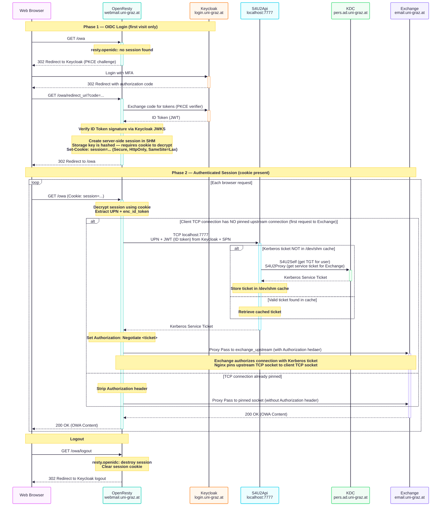
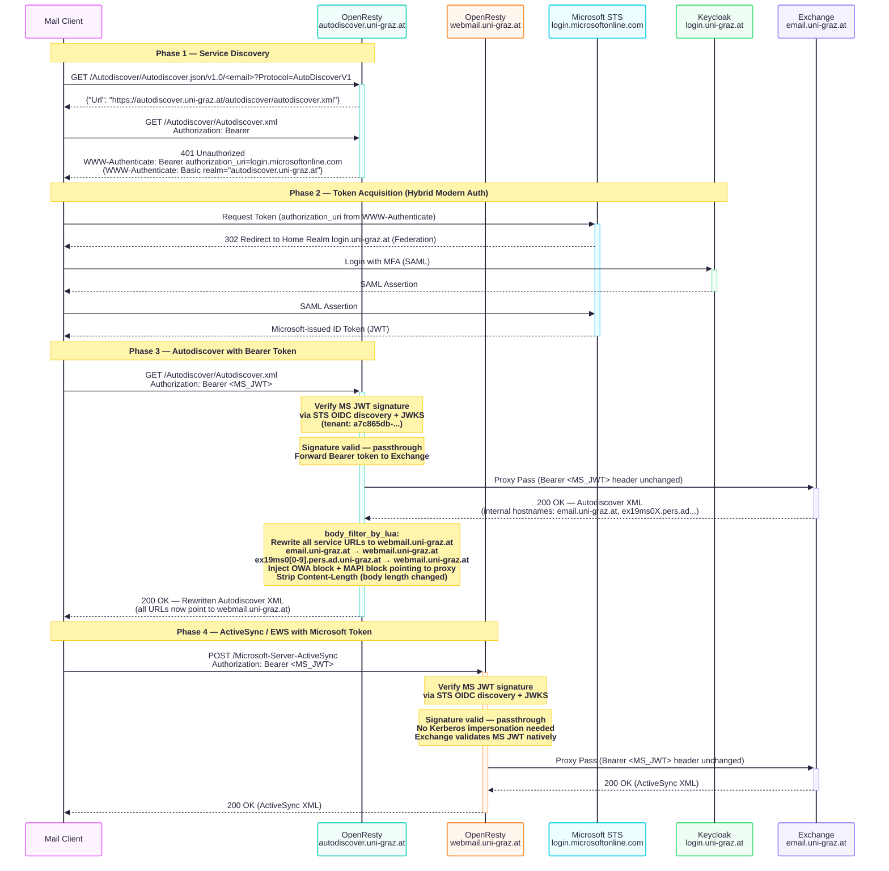
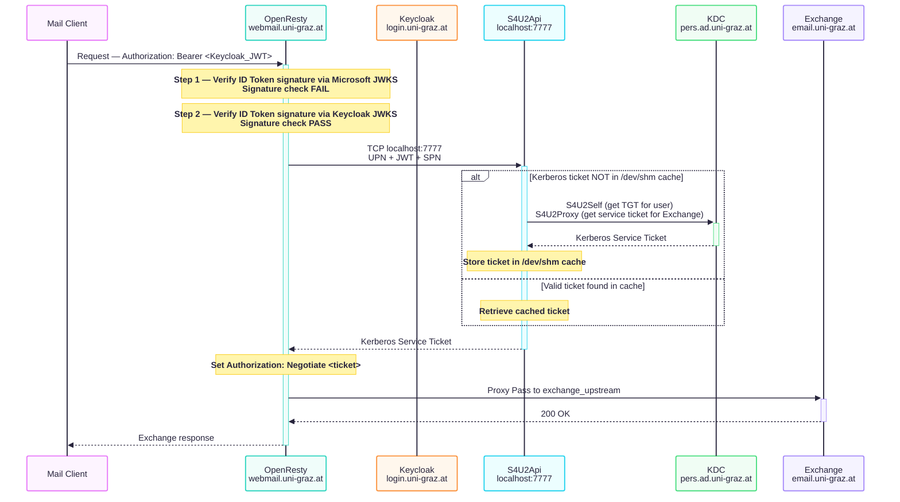
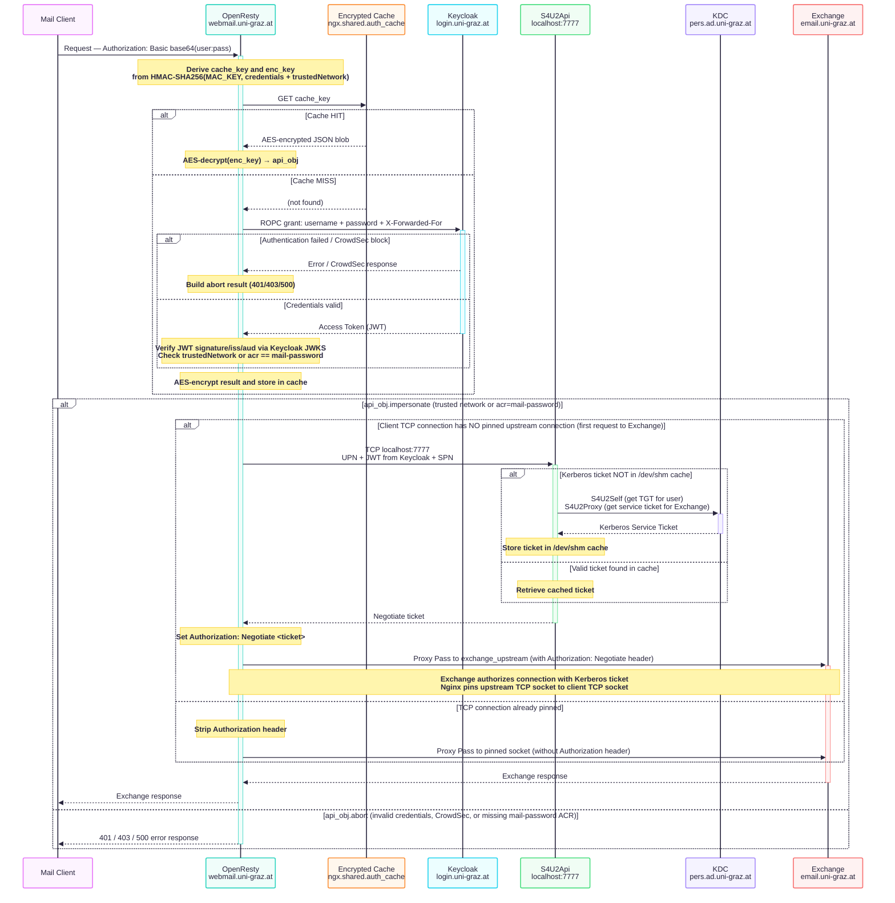
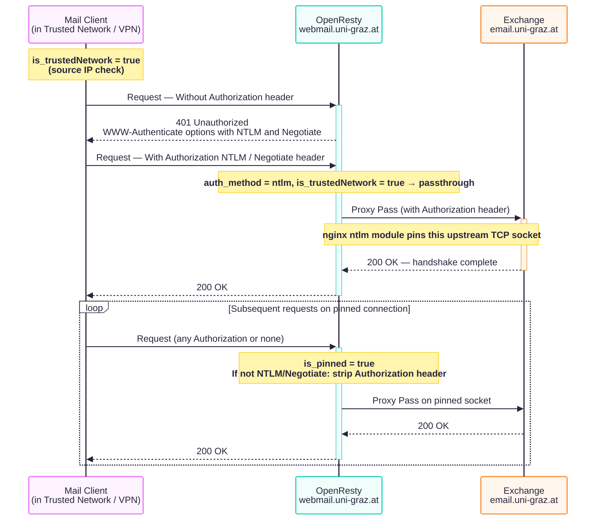
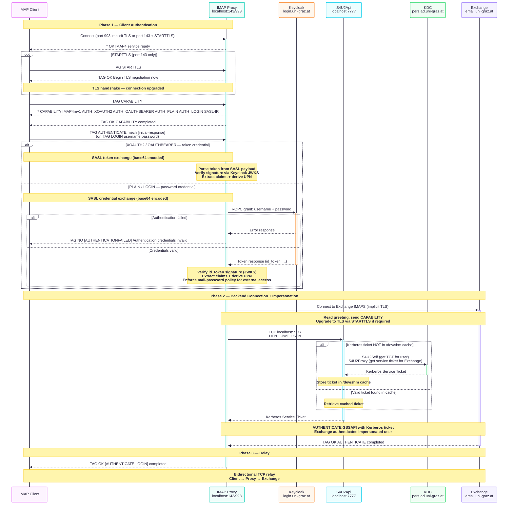

# MSX Proxy — Architecture Documentation

> Pre-authentication & protocol bridging proxy for Microsoft Exchange  
> Platform: OpenResty (nginx + LuaJIT) + Python (asyncio)

---

## Executive Summary

The MSX Proxy is a security gateway placed in front of an on-premises Microsoft Exchange server. It enforces modern, policy-controlled authentication for every request before Exchange ever sees it — Exchange itself receives only credentials it already understands (Kerberos Negotiate tokens or Microsoft-issued Bearer JWTs) and has no awareness of the modern identity layer in front of it.

### The Problem It Solves

Exchange exposes several protocol surfaces: OWA (browser webmail), EWS (calendar and contacts sync), ActiveSync (mobile push mail), IMAP/SMTP (standard mail clients), and Autodiscover (automatic client configuration). Without a proxy, external access to any of these would require exposing raw NTLM/Basic authentication — a protocol family with well-known weaknesses — directly to the internet. The alternative, forcing all users into Microsoft Entra cloud identity, would remove the organization's control over its own credential infrastructure.

The proxy resolves this by owning the internet-facing authentication entirely, in a way that is transparent to both Exchange and the mail clients.

### What the Proxy Does

**For browser users (OWA):** A full OpenID Connect authorization code flow with PKCE is conducted against the organization's Keycloak identity provider. The user authenticates once; the proxy manages the session via encrypted server-side cookies. On every new connection the proxy uses the Kerberos S4U2Proxy constrained delegation protocol to silently impersonate the user toward Exchange and pins the now authenticated TCP backend connection to the client's TCP socket. The user's password never touches the proxy.

**For mobile devices and mail clients using Basic credentials (ActiveSync/EWS/MAPI):** OpenResty validates credentials directly by performing an OIDC Resource Owner Password Credentials (ROPC) grant against Keycloak (`openresty/lua/keycloak.lua`) and verifying the returned JWT via `lua-resty-openidc`. Keycloak's ACR (Authentication Context Class Reference) claim determines the outcome: `mail-password` ACR (or a trusted network source) grants Exchange access via S4U2Proxy impersonation. External clients authenticating without `acr=mail-password` receive `403 Forbidden`. Results are stored AES-encrypted in `ngx.shared.auth_cache`.

**For IMAP/SMTP clients:** The proxy accepts standard SASL mechanisms (PLAIN, LOGIN, XOAUTH2, OAUTHBEARER) on ports 143/993 and 587/465. Password credentials are validated via Keycloak ROPC; tokens are verified directly against Keycloak JWKS. External access requires a dedicated mail password (ACR `mail-password`) — regular passwords are blocked outside the trusted network. After authentication, the proxy connects to Exchange IMAPS/SMTPS, impersonates the user via GSSAPI (Kerberos) on the backend, and then relays the connection bidirectionally.

**For devices using Hybrid Modern Authentication (HMA):** Clients that support HMA obtain a JWT directly from Microsoft's identity platform via home-realm federation to Keycloak. The proxy validates the Microsoft-issued JWT cryptographically and passes it through to Exchange unchanged. Exchange validates it independently via its own Microsoft STS trust relationship.

**For Autodiscover:** The proxy intercepts all client self-configuration requests. JSON responses are generated synthetically with no upstream call. XML responses are fetched from Exchange and rewritten in-flight, replacing all internal hostnames with the proxy address, so all subsequent client connections return through the proxy regardless of what the client discovers.

### Security Architecture

**Pre-authentication guarantee:** Exchange never receives an unauthenticated or weakly-authenticated request from the internet. Every external connection is fully validated before any upstream proxy pass occurs.

**Credential cache security:** The OpenResty auth result cache (ngx.shared.auth_cache) stores responses encrypted. The AES key is derived from an HMAC-SHA256 of the credentials keyed with a server-side MAC key. The cache lookup key is a separate SHA256 hash of the same HMAC. A cache entry is unreadable without the original credentials, and the cache key cannot be reversed to obtain them.

**Session security:** OWA sessions use server-side SHM storage with a hashed storage key. Session data cannot be decrypted with server access alone — the client cookie is required to reconstruct the decryption key.

**Network segmentation:** NTLM/Negotiate passthrough is gated strictly to `143.50.0.0/16` and `10.0.0.0/8`. External clients presenting these headers receive `403 Forbidden`. Both OpenResty (Basic Auth) and the IMAP/SMTP proxy enforce the `mail-password` ACR requirement for all external ROPC-authenticated connections.

### Components at a Glance

| Component | Technology | Role |
|---|---|---|
| **OpenResty** (`webmail.uni-graz.at`) | nginx + LuaJIT | TLS termination, OIDC session management, Basic/Bearer auth (Keycloak ROPC + JWKS), rate limiting, protocol bridging, connection pinning |
| **OpenResty** (`autodiscover.uni-graz.at`) | nginx + LuaJIT | Autodiscover endpoint identical to webmail, XML/JSON rewriting |
| **IMAP/SMTP Proxy** (`localhost:143/993/587/465`) | Python / asyncio | SASL auth (PLAIN, LOGIN, XOAUTH2, OAUTHBEARER); Keycloak ROPC + JWT verify; GSSAPI backend auth; bidirectional relay |
| **Keycloak** (`login.uni-graz.at`) | Keycloak | OIDC IdP; issues tokens; enforces MFA; manages mail passwords; controls ACR claims |
| **S4U2Api** (`localhost:7777`) | Custom daemon | Kerberos S4U2Self + S4U2Proxy delegation; service ticket cache in `/dev/shm` |
| **KDC** (`pers.ad.uni-graz.at`) | Active Directory | Kerberos Key Distribution Center |
| **Exchange** (`email.uni-graz.at`) | MS Exchange | On-premises mail server; receives only Kerberos Negotiate, GSSAPI, or Microsoft Bearer tokens |
| **Microsoft STS** (`login.microsoftonline.com`) | Azure AD / Entra | Issues tokens for Hybrid Modern Authentication clients |

---

## Flow 1 — OWA Browser Webmail

Users accessing `https://webmail.uni-graz.at/owa` go through a full OIDC authorization code flow with PKCE against Keycloak. After login, subsequent requests use an encrypted server-side session. S4U2Api performs Kerberos impersonation on the first request of each TCP connection; that upstream socket is then pinned so later requests on the same connection are passed through without re-authentication.



---

## Flow 2 — HMA: Hybrid Modern Authentication

Mobile and desktop clients that support Hybrid Modern Authentication obtain a JWT from Microsoft's identity platform via home-realm federation to Keycloak. The proxy validates the Microsoft-issued JWT signature and passes it through to Exchange unchanged. Exchange validates it independently using its own Microsoft STS trust relationship. Autodiscover responses are rewritten in-flight so all discovered service URLs point to the proxy.



---

## Flow 3 — Modern Authentication on-premises with Keycloak

Clients holding a Keycloak access token present it as a Bearer token. The proxy attempts Microsoft STS verification first; on failure it falls back to Keycloak verification. On success it performs S4U2Proxy impersonation.



---

## Flow 4 — Basic Authentication: Credential Validation and ACR Routing

When a client presents Basic credentials, OpenResty checks the encrypted cache first. On a cache miss it validates credentials directly against Keycloak via an OIDC ROPC grant (`keycloak.lua`), verifies the returned access token via Keycloak JWKS (`lua-resty-openidc`), and checks `acr == "mail-password"` (or trusted network) before requesting S4U2Proxy impersonation.



---

## Flow 5 — NTLM / Negotiate Passthrough (Trusted Network Only)

Clients on the corporate network or VPN may use Windows Integrated Authentication. The proxy detects NTLM or Negotiate headers and passes them to Exchange unmodified. This flow is gated to the corporate network and VPN — all other sources receive `403 Forbidden`.



---

## IMAP and SMTP

The IMAP proxy accepts standard SASL mechanisms from clients on ports 143 (STARTTLS) and 993 (implicit TLS). After validating the client's credential — either by verifying a token via JWKS or by performing a Keycloak ROPC grant — the proxy connects to Exchange IMAPS, impersonates the authenticated user using the same S4U2Api Kerberos delegation used by all other flows, and then relays the connection transparently. SMTP works identically on ports 587/465.



---

## Authentication Method Decision Matrix

| Client | Protocol | Network | Credential | Authentication path | Exchange sees |
|---|---|---|---|---|---|
| Browser | HTTPS / OWA | Any | OIDC session cookie | resty.openidc → S4U2Proxy | Kerberos Negotiate |
| EWS/EAS/MAPI | HTTPS | Any | Bearer — Microsoft JWT | STS JWKS verify → passthrough | Bearer (MS JWT) |
| EWS/EAS/MAPI | HTTPS | Any | Bearer — Keycloak JWT | Keycloak JWKS verify → S4U2Proxy | Kerberos Negotiate |
| EWS/EAS/MAPI | HTTPS | Trusted | Basic — any ACR | OpenResty ROPC → S4U2Proxy | Kerberos Negotiate |
| EWS/EAS/MAPI | HTTPS | Any | Basic — `acr=mail-password` | OpenResty ROPC → S4U2Proxy | Kerberos Negotiate |
| EWS/EAS/MAPI | HTTPS | External | Basic — regular password | OpenResty → 403 Forbidden | _(not forwarded)_ |
| EWS/EAS/MAPI | HTTPS | Trusted | NTLM / Negotiate | Passthrough | NTLM / Negotiate |
| Thunderbird | IMAP/SMTP | Any | XOAUTH2 / OAUTHBEARER | Keycloak JWKS verify → S4U2Proxy | Kerberos Negotiate |
| Thunderbird | IMAP/SMTP | Any | PLAIN / LOGIN — `acr=mail-password` | ROPC → Keycloak → S4U2Proxy | Kerberos Negotiate |
| Thunderbird | IMAP/SMTP | Trusted network | PLAIN / LOGIN — any ACR | ROPC → Keycloak → S4U2Proxy | Kerberos Negotiate |
| Thunderbird | IMAP/SMTP | External | PLAIN / LOGIN — regular password | ROPC → Keycloak → TrustedNetworkError → 403 | _(not forwarded)_ |
| Any client | Any | Any | Invalid credentials | Auth failure | _(not forwarded)_ |

---

## Deployment (Ubuntu / Git-Based)

Clone directly into `/opt/msxproxy`, keep all secrets/config outside the repo in `/etc/msxproxy/`, and use [deploy/deploy.sh](deploy/deploy.sh) to link OpenResty, systemd units, and `tmpfiles.d` without copying files:

```bash
git clone <repo-url> /opt/msxproxy
cd /opt/msxproxy
sudo ./deploy/deploy.sh install
```

Then add two lines to `/usr/local/openresty/nginx/conf/nginx.conf`:
- Top level: `load_module /usr/local/openresty/modules/ngx_http_upstream_ntlm_module.so;`
- Inside `http {}`: `include /opt/msxproxy/deploy/openresty/msxproxy-http.conf;`

Populate the configs installed in `/etc/msxproxy/` (templates live in `deploy/etc/`):
- `/etc/msxproxy/config.lua` (OpenResty)
- `/etc/msxproxy/mailproxy.toml` (IMAP/SMTP proxy — all settings + client secret)
- `/etc/msxproxy/s4u2api.toml` + `/etc/msxproxy/krb5_keytab` (S4U2Proxy daemon)

Then verify and start:

```bash
sudo ./deploy/deploy.sh check
sudo systemctl enable --now s4u2api mailproxy openresty
```

### Upgrading, Reloading & Rolling Back

```bash
sudo /opt/msxproxy/deploy/deploy.sh reload          # zero-downtime cert/config reload (OpenResty + mailproxy SIGHUP)
sudo /opt/msxproxy/deploy/deploy.sh update          # git pull --ff-only + pytest + nginx -t + reload/restart
sudo /opt/msxproxy/deploy/deploy.sh update v1.2.0   # deploy or roll back to a specific git tag
```
