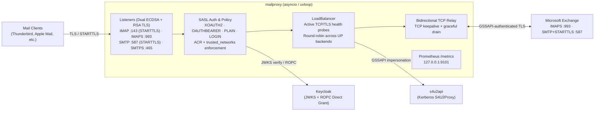
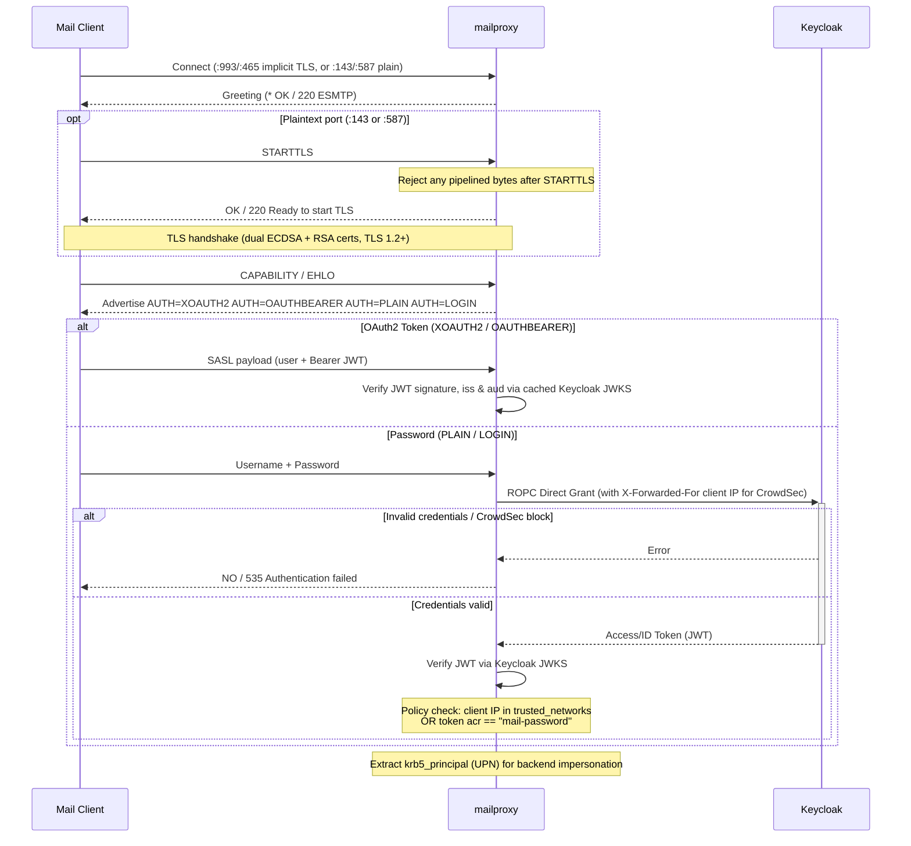
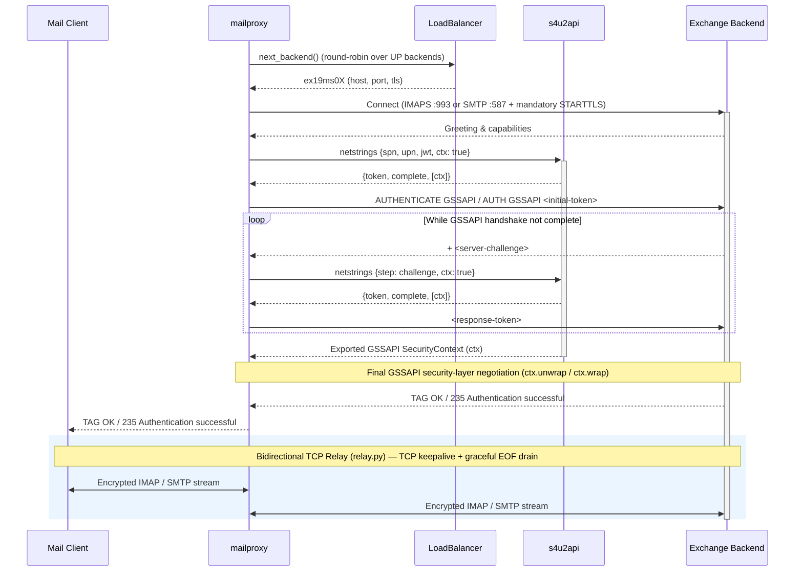

# Mailproxy (IMAP / SMTP Authentication Proxy)

Asynchronous Python (`asyncio` + `uvloop`) authentication and protocol-bridging proxy for **IMAP/IMAPS** (`143` / `993`) and **SMTP/SMTPS** (`587` / `465`) in front of Microsoft Exchange.

Mailproxy terminates client TLS, enforces modern authentication policies against **Keycloak**, obtains Kerberos S4U2Proxy service tickets from **`s4u2api`**, authenticates to Exchange backends using **GSSAPI**, and then relays traffic transparently in both directions.

---

## Architecture Overview



---

## Sequence Diagrams

### 1. Client TLS, SASL Authentication & Policy Enforcement

Every client connection must be encrypted (implicit TLS on `993`/`465` or upgraded via `STARTTLS` on `143`/`587`) before any authentication mechanism is accepted. Pipelined commands after `STARTTLS` are rejected, and unauthenticated connections are closed after `auth_timeout`.



### 2. Backend Load Balancing, GSSAPI Impersonation & Relay

Once the client is authenticated, `mailproxy` picks the next healthy Exchange server from the protocol's `LoadBalancer`, establishes a TLS-verified backend session (`IMAPS` or mandatory `STARTTLS` for `SMTP`), performs the multi-step `GSSAPI` handshake through `s4u2api`, and hands the sockets off to the bidirectional relay.



---

## Security & Operational Highlights

- **Strict TLS enforcement:** Cleartext authentication is blocked; `STARTTLS` pipelining is rejected; backend SMTP requires `STARTTLS` (cleartext downgrade refused); TLS 1.2+ with dual ECDSA + RSA certificate support.
- **Pre-authentication isolation:** Post-auth IMAP commands (`SELECT`, `FETCH`, `IDLE`, etc.) and SMTP relay commands (`MAIL FROM`, `RCPT TO`, `DATA`, `BDAT`) are rejected before authentication succeeds.
- **Brute-force protection & built-in multi-worker rate limiting:** Client source IPs are forwarded via `X-Forwarded-For` on Keycloak ROPC requests for Keycloak / CrowdSec, AND a built-in shared-memory per-IP rate limiter (`ratelimit.py`, ~5.5 MiB fixed anonymous `mmap`, 131,072 slots) enforces incremental bans across all forked workers (`--workers > 1`) and all four ports (`143`, `993`, `587`, `465`) with zero external dependencies (completely isolated from `s4u2api`'s Valkey and Kerberos ccaches). `TrustedNetworkError` and upstream Keycloak outages are excluded from ban counts, matching OpenResty.
- **Active load balancing:** Background health probes mark backends `DOWN` after `fall` consecutive failures and `UP` after `rise` consecutive successes, without interrupting established connections.
- **Multi-worker scalability:** `--workers N` forks workers sharing pre-bound `SO_REUSEPORT` sockets, with shared-memory Prometheus counters and coordinated `SIGHUP` / `SIGTERM` handling.

---

## Configuration & Hot Reload

All settings and secrets live in `/etc/msxproxy/mailproxy.toml` (template: [`../deploy/etc/mailproxy.toml.example`](../deploy/etc/mailproxy.toml.example)), overridable via `--config` or `MAILPROXY_CONFIG`.

Sending `SIGHUP` (`systemctl reload mailproxy` or `./docker/msxproxy.sh reload mailproxy`) **hot-reloads without dropping active connections**:
- TLS certificate & key chains (`[proxy].certs`)
- `[oidc]` credentials, discovery metadata, and Keycloak JWKS
- `[proxy]` settings & `trusted_networks`, `[s4u2api]` target
- `[imap]` & `[smtp]` backend pools (for new connections, preserving existing backend health state) and capabilities
- `[loadbalancer]` probe thresholds and `[ratelimit]` settings (`enabled`, `base_bantime`, `findtime`, `maxretry`, `max_bantime`, `ignore_networks`)

*(Changing listening hosts or ports requires a restart.)*

---

## CLI Options

```bash
python3 -m mailproxy \
  --config /etc/msxproxy/mailproxy.toml \
  --workers 1 \
  --log INFO \
  --metrics-host 127.0.0.1 \
  --metrics-port 9101
```

| Flag | Default | Description |
|---|---|---|
| `--config` | `/etc/msxproxy/mailproxy.toml` | Path to TOML configuration file (also `MAILPROXY_CONFIG`) |
| `--log` | `INFO` | Log level (`DEBUG`, `INFO`, `WARNING`, `ERROR`, `CRITICAL`) |
| `--workers` | `1` | Number of forked worker processes |
| `--metrics-host` | `127.0.0.1` | Bind address for Prometheus HTTP `/metrics` endpoint |
| `--metrics-port` | *(disabled)* | Bind port for Prometheus `/metrics` (reverse-proxied by OpenResty at `/metrics/mailproxy`) |

---

## Prometheus Metrics

When `--metrics-port` is enabled, `GET /metrics` exposes Prometheus text format (`0.0.4`) aggregated across all workers:

| Metric | Type | Labels | Description |
|---|---|---|---|
| `mailproxy_connections_total` | counter | `protocol` (`imap`, `smtp`) | Total client connections accepted |
| `mailproxy_connections_active` | gauge | `protocol` | Currently active client connections |
| `mailproxy_auth_total` | counter | `protocol`, `result` (`ok`, `failed`, `trusted_network_denied`, `ratelimited`, `error`) | Client authentication outcomes |
| `mailproxy_ratelimit_bans_total` | counter | — | Total IP bans triggered by the mailproxy rate limiter |
| `mailproxy_backend_errors_total` | counter | `protocol` | Backend connection or GSSAPI auth failures |
| `mailproxy_backend_up` | gauge | `pool` (`imap`, `smtp`), `backend` | Exchange backend health (`1` = UP, `0` = DOWN) |

---

## Deployment

See [`../INSTALL.md`](../INSTALL.md) for Ubuntu bare-metal deployment (`deploy/systemd/mailproxy.service`) or [`../docker/README.md`](../docker/README.md) for Docker Compose deployment.
