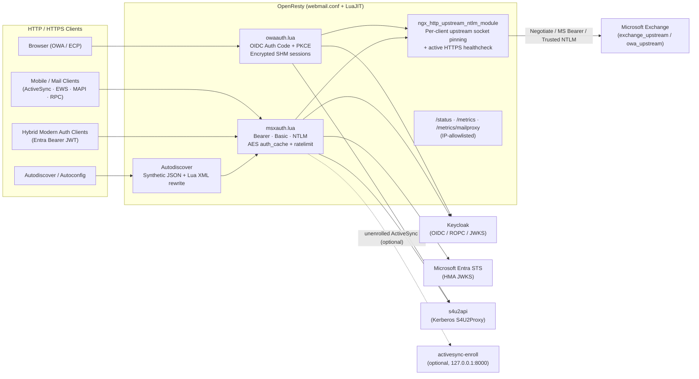
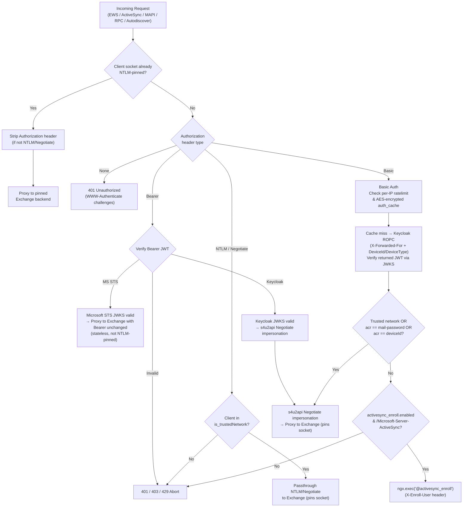

# OpenResty Edge Proxy

OpenResty (Nginx + LuaJIT) HTTP/HTTPS reverse proxy and pre-authentication gateway for Microsoft Exchange (`webmail`, `autodiscover`, and `autoconfig`).

It terminates client TLS (dual ECDSA + RSA), enforces modern authentication policies in Lua before any request reaches Exchange, pins Kerberos/NTLM-authenticated backend TCP sockets to client connections via `ngx_http_upstream_ntlm_module`, rewrites Autodiscover responses in flight, and exposes operational `/status` and Prometheus `/metrics` endpoints.

---

## Architecture Overview

---

## Request Authentication Flow (`msxauth.lua`)

---

## Repository Layout

| Path | Role |
|---|---|
| `conf.d/webmail.conf` | Virtual hosts (`webmail`, `autoconfig`, `autodiscover`), Exchange upstreams (`ntlm` + `ip_hash`), active health checker, Autodiscover XML body filter, `@activesync_enroll`, `/status`, `/metrics`, and `/metrics/mailproxy` |
| `lua/msxauth.lua` | Core access handler for ActiveSync, EWS, MAPI, RPC, and Autodiscover (Bearer, Basic, NTLM, AES-encrypted `auth_cache`, ACR routing) |
| `lua/owaauth.lua` | OWA / ECP browser handler using `lua-resty-openidc` (Authorization Code + PKCE, encrypted server-side SHM sessions, clean logout) |
| `lua/keycloak.lua` | Direct Grant (ROPC) HTTP client with `X-Forwarded-For` forwarding, ActiveSync `DeviceId`/`DeviceType` parameters, and CrowdSec block detection |
| `lua/s4u2api.lua` | Keepalive TCP netstrings client requesting Kerberos Negotiate tokens from `s4u2api` |
| `lua/authorization.lua` | `Authorization` header parser (Basic, Bearer, NTLM, Negotiate) |
| `lua/ratelimit.lua` | Shared-dictionary per-IP exponential backoff rate limiter for failed Basic Auth attempts |
| `lua/netstrings.lua` | Netstrings encoder/decoder shared with `s4u2api` |
| `lua/metrics.lua` | Zero-dependency Prometheus text exporter backed by `ngx.shared.metrics` |
| `html/activesync_enroll_complete.html` | Static completion page shown after ActiveSync DeviceID enrollment |
| `www/autoconfig/mail/config-v1.1.xml` | Mozilla Thunderbird Autoconfig XML served on the `autoconfig` vhost |

The top-level `http {}` include snippet (`lua_shared_dict` zones, trusted CA bundle, `lua_package_path`, and `include conf.d/*.conf`) lives at [`../deploy/openresty/msxproxy-http.conf`](../deploy/openresty/msxproxy-http.conf).

---

## Configuration & Hot Reload

Deployment-specific hostnames, OIDC client secrets, `mac_key_b64`, `owa.session_secret`, `s4u2api` address, rate-limit thresholds, and the optional `activesync_enroll` toggle live outside the repo in `/etc/msxproxy/config.lua` (template: [`../deploy/etc/config.lua.example`](../deploy/etc/config.lua.example)).

After editing `webmail.conf`, any Lua file in `openresty/lua/`, `/etc/msxproxy/config.lua`, or renewing TLS certificates in `/etc/msxproxy/ssl/`, perform a **zero-downtime reload**:

- **Docker Compose:** `./docker/msxproxy.sh reload openresty`
- **Bare-metal systemd:** `sudo ./deploy/deploy.sh reload` (validates with `nginx -t` first)

Static files in `openresty/html/` and `openresty/www/autoconfig/` are read directly from disk and take effect immediately without reloading.

---

## Operational Endpoints & Prometheus Metrics

All operational endpoints on the `webmail` vhost are restricted to the internal IP allowlist in `conf.d/webmail.conf`:

- `GET /status` — Current Nginx worker PID and `lua-resty-upstream-healthcheck` status for `exchange_upstream`.
- `GET /metrics` — OpenResty Prometheus metrics (`text/plain; version=0.0.4`):
  - `msxproxy_auth_total{method,result}`
  - `msxproxy_auth_cache_total{result}`
  - `msxproxy_ratelimit_bans_total`
  - `msxproxy_crowdsec_blocks_total{type}`
  - `msxproxy_s4u2api_requests_total{result}`
- `GET /metrics/mailproxy` — Reverse-proxied `mailproxy` Prometheus metrics (`http://127.0.0.1:9101/metrics`) over HTTPS.

---

## Deployment

See [`../INSTALL.md`](../INSTALL.md) for Ubuntu bare-metal setup (OpenResty, `lua-resty-openidc`, and compiling `ngx_http_upstream_ntlm_module.so`) or [`../docker/README.md`](../docker/README.md) for Docker Compose deployment.
