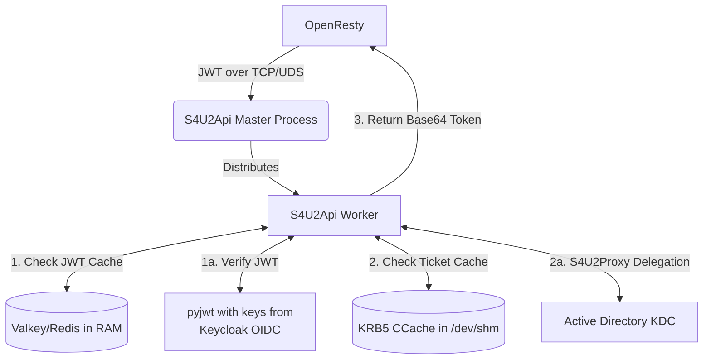
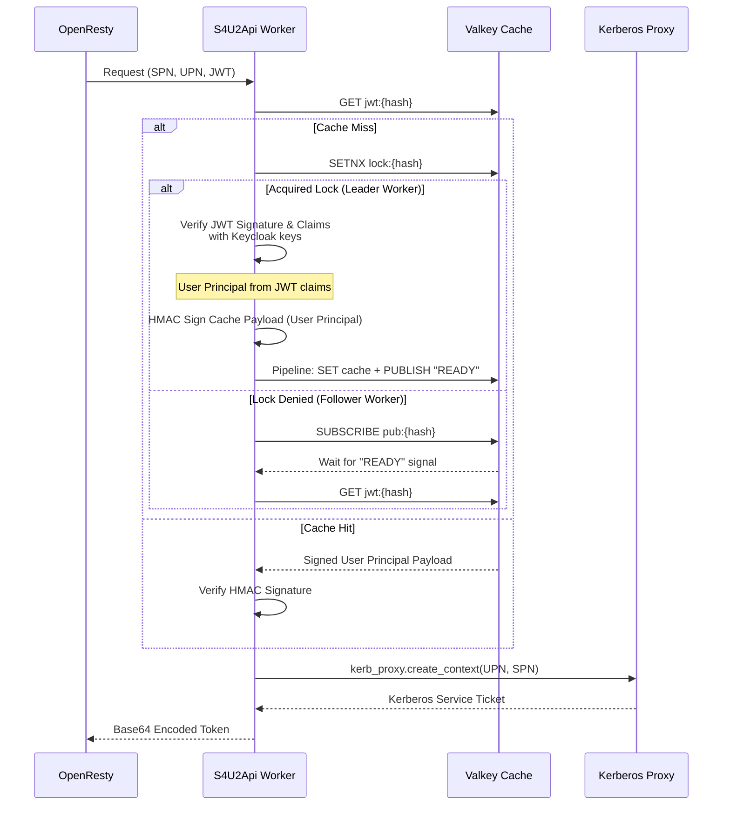
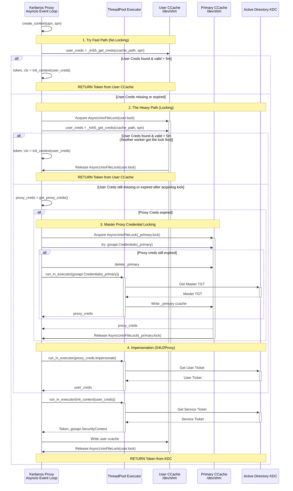

# S4U2Api

Use [ktutil](https://web.mit.edu/kerberos/krb5-1.12/doc/admin/admin_commands/ktutil.html) to create the keytab file.

## Overview



### Executive Summary

S4U2Api is a specialized middleware service acting as a bridge between modern OpenID Connect (OIDC) authentication and legacy Kerberos infrastructure.  
It is explicitly designed to translate Keycloak JWTs into Kerberos Service Tickets for Microsoft Exchange components like HTTP, IMAP, and SMTP.

The project leverages the Kerberos S4U2Proxy (Constrained Delegation) extension.  
When a user authenticates via OIDC, this API takes the provided JWT, cryptographically verifies it, and instructs the Kerberos Key Distribution Center (KDC) to issue a ticket on behalf of that user to the target service.

The architecture bridges modern asynchronous Python (asyncio) with synchronous, C-based Kerberos and GSSAPI libraries by offloading blocking network/crypto operations to thread pools.  
It implements an aggressive on-disk caching layer using the RAM-backed /dev/shm filesystem and file-based locking to prevent "thundering herd" scenarios against the Active Directory Key Distribution Center (KDC).

Overall, the codebase utilizes modern asynchronous Python (asyncio, uvloop) and an efficient caching mechanism to handle high loads.


## Worker Sequence Diagram



## Kerberos Sequence Diagram




## Dependencies

```
apt install valkey-server
useradd -r -m -d /opt/s4u2api -s /usr/sbin/nologin -K UMASK=0077 s4u2api
usermod -aG valkey s4u2api
```

`/etc/valkey/valkey.conf`
```
# valkey.conf

port 0
unixsocket /dev/shm/valkey.sock
unixsocketperm 660

# Disable all disk persistence for the JWT cache
save ""
appendonly no

maxmemory 64mb
maxmemory-policy allkeys-lru

loglevel notice
```

```
apt install python3-uvloop python3-gssapi python3-jwt python3-httpx python3-redis python3-filelock krb5-user
```

## SystemD Service

`/etc/systemd/system/s4u2api.service`
```
[Unit]
Description=S4U2Proxy Python API
After=network.target valkey-server.service
Requires=valkey-server.service

[Service]
Type=simple
User=s4u2api
Group=s4u2api

LoadCredential=krb5_keytab:/root/_msxproxy.keytab

ProtectSystem=strict
PrivateTmp=yes
ReadWritePaths=/dev/shm

LimitNOFILE=65535
WorkingDirectory=/opt/s4u2api
ExecStart=/usr/bin/python3 -m s4u2api --host 127.0.0.1 --port 7777

Restart=always
RestartSec=5

[Install]
WantedBy=multi-user.target
```

## CCache Cleanup (`systemd-tmpfiles`)

`/etc/tmpfiles.d/s4u2api.conf`
```
d /dev/shm/krb5_msxproxy 0700 s4u2api s4u2api 1d
```

Apply immediately with `systemd-tmpfiles --create /etc/tmpfiles.d/s4u2api.conf`. Files older than 24 hours (`1d`) are pruned automatically by `systemd-tmpfiles-clean.timer`.
