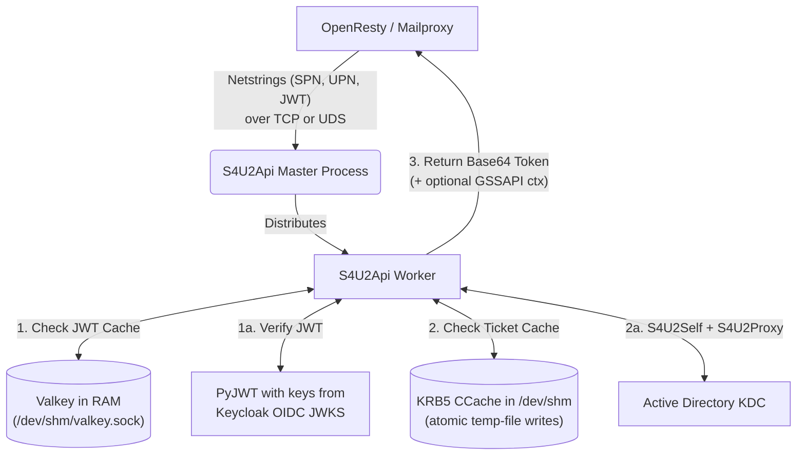
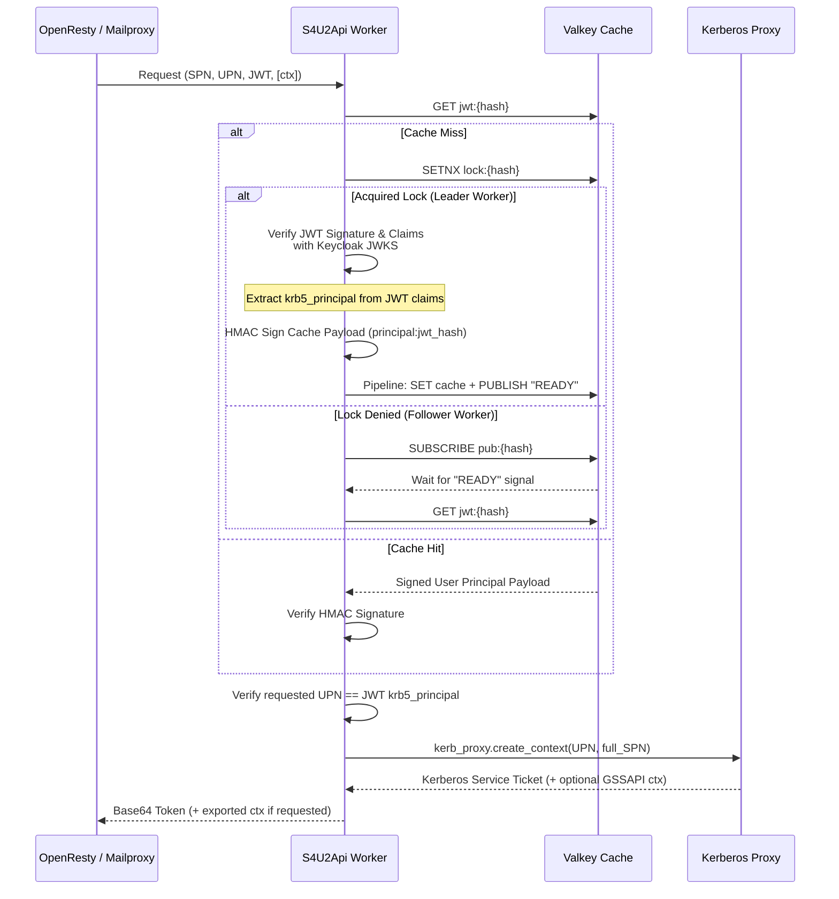
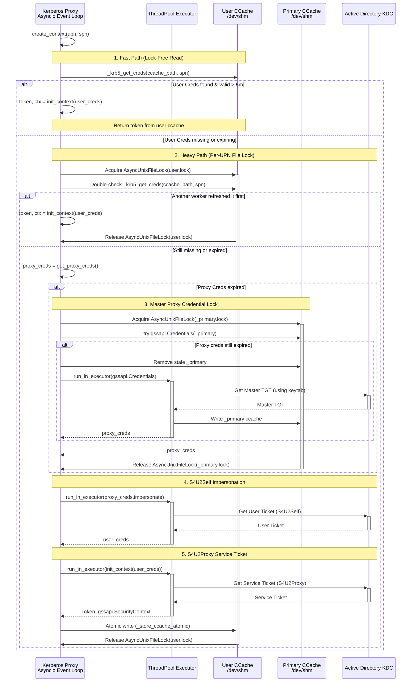

# S4U2Api

Specialized Kerberos S4U2Self / S4U2Proxy impersonation daemon bridging modern OpenID Connect (OIDC) JWTs from **Keycloak** into Kerberos service tickets for Microsoft Exchange (HTTP, IMAP, and SMTP).

---

## Overview



### Executive Summary

S4U2Api translates verified Keycloak JWTs into Kerberos Service Tickets via Active Directory **Constrained Delegation (S4U2Self + S4U2Proxy)**.

- **Asyncio + ThreadPool bridge:** Uses `asyncio` + `uvloop` for high-concurrency netstrings framing while offloading blocking C-level GSSAPI / KDC operations to thread pools.
- **Stampede-resistant JWT cache:** Verified JWTs are cached in RAM-only **Valkey** with per-process HMAC-SHA256 integrity signatures and Redis `SET NX` + Pub/Sub leader/follower coordination so concurrent requests for the same token verify it once.
- **Lock-free fast path for Kerberos tickets:** Per-user tickets are stored in `/dev/shm` using atomic write-and-rename (`os.replace`), allowing lock-free reads via a pure-Python MIT KRB5 ccache parser (`ccache.py`) while serializing KDC renewals per UPN with `AsyncUnixFileLock`.

---

## Worker Sequence Diagram



---

## Kerberos Sequence Diagram



---

## Wire Protocol (`aionetstrings`)

Clients communicate over a persistent TCP or Unix Domain Socket connection using typed netstring dictionaries:

- **Initial request:** `{"spn": "http", "upn": "user@REALM", "jwt": "<keycloak_jwt>", "ctx": false}`
  - `spn` must match a short name configured under `[valid_spns]`.
  - `ctx: true` (used by `mailproxy`) keeps the `gssapi.SecurityContext` open on the connection for multi-round `{"step": "<base64>"}` exchanges and returns the exported context bytes once `complete` is `true`.
- **Response:** `{"token": "<base64>", "complete": true}` (plus `"ctx": <bytes>` when requested), or `{"error": "<message>"}` on failure.

---

## Configuration & Hot Reload

Configuration lives in `/etc/msxproxy/s4u2api.toml` (template: [`../deploy/etc/s4u2api.toml.example`](../deploy/etc/s4u2api.toml.example)), overridable via `S4U2API_CONFIG`. Under systemd, `LoadCredential=krb5_keytab:...` automatically takes precedence over `[kerberos].keytab`.

Sending `SIGHUP` (`systemctl reload s4u2api` or `./docker/msxproxy.sh reload s4u2api`) **hot-reloads without restarting**:
- `[valid_spns]` mapping
- `[oidc]` discovery metadata and Keycloak JWKS (atomic swap; preserves previous JWKS on error)
- `[kerberos]` principal, `ccache_dir`, and rotated `krb5_keytab` (clears cached `proxy_creds`)
- Flushes the Valkey JWT cache so stale entries do not linger

---

## CLI Options

```bash
python3 -m s4u2api --host 127.0.0.1 --port 7777 --workers 1 --log INFO
```

| Flag | Default | Description |
|---|---|---|
| `--host` / `--port` | From `s4u2api.toml` (`127.0.0.1:7777`) | TCP listen address and port |
| `--uds` | From `s4u2api.toml` (`None`) | Unix domain socket path with optional `:octal_mode` suffix (overrides TCP) |
| `--workers` | `1` | Number of worker processes |
| `--log` | `INFO` | Log level (`DEBUG`, `INFO`, `WARNING`, `ERROR`, `CRITICAL`) |
| `--cert` / `--key` | *(none)* | Optional TLS certificate & key for remote TCP listeners |

---

## CCache Cleanup

`s4u2api` automatically creates `ccache_dir` (default `/dev/shm/krb5_msxproxy`, mode `0700`) and runs a background hourly pruning task that removes per-user ccache and lock files older than 24 hours (while keeping `_primary`).

---

## Deployment

See [`../INSTALL.md`](../INSTALL.md) for Ubuntu bare-metal setup (Valkey, keytab creation with `ktutil`, and `deploy/systemd/s4u2api.service`) or [`../docker/README.md`](../docker/README.md) for Docker Compose deployment.
